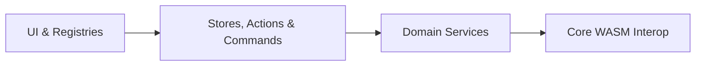

# AGENTS.md

KeaPDF is a browser-native PDF editor built with **Svelte 5**, **TypeScript**, **Tailwind CSS v4**, and **PDFium** WebAssembly. All parsing, rendering, editing, conversion, OCR, and cryptographic signing run client-side in browser memory.

---

## Essential Commands

| Command | Description |
|:---|:---|
| `bun install` | Install dependencies from `bun.lock`. |
| `bun run dev` | Start the Vite development server on `http://localhost:3000`. |
| `bun test` | Run the full test suite via the Bun test runner. |
| `bun test path/to/file.test.ts` | Run a single test file or pattern. |
| `bunx svelte-check` | Run Svelte 5 compiler and TypeScript diagnostics. |
| `bun run build` | Run type-checks and build the production bundle into `dist/`. |
| `bun run preview` | Preview the production build locally from `dist/`. |
| `bun run deploy` | Build and deploy static assets to Cloudflare Workers via Wrangler. |
| `bun run find-style <query>` | Scan stylesheets and components for CSS tokens, classes, and selectors. |

---

## Technology Stack

| Layer | Technology | Details |
|:---|:---|:---|
| **Runtime & Package Manager** | [Bun](https://bun.sh/) | Exclusive package manager, script runner, and test runner (`bun.lock`). |
| **Framework** | Svelte 5 | Runes (`$state`, `$derived`, `$props`, `$effect`) and `{#snippet}` templates. |
| **Language** | TypeScript | Strict mode (`ES2022` target, `noImplicitReturns`, `noUnusedLocals`). |
| **Styling & UI** | Tailwind CSS v4 + `bits-ui` | `@theme inline` OKLCH tokens in `src/app.css`, `tailwind-variants`, `paneforge`, `lucide-svelte`. |
| **PDF Engine** | `@embedpdf/pdfium` + `pdf-lib` | WASM rendering/FFI operations and structural PDF/AcroForm serialisation. |
| **Crypto & OCR** | `node-forge` + `tesseract.js` | Client-side PKCS#7 signing, RC4/AES encryption, and Web Worker OCR. |

---

## Architecture

Dependencies flow strictly in one direction from presentation components down to the WebAssembly engine:



```text
src/
├── commands/     # Invertible Command classes for undo/redo and burst coalescing
├── components/   # Svelte 5 UI shell (layout/), viewport (canvas/), panels/, and dialogs/
├── core/         # PDFium singleton, RAII helpers, registries, feature flags, optimistic queue, WebMCP
├── elements/     # Canvas overlay element definitions and Svelte 5 renderers
├── lib/          # Shared shadcn-svelte UI primitives (components/ui/) and interaction hooks
├── panels/       # Left navigation rail panel registrations
├── plugins/      # Built-in plugins consuming the sandboxed Plugin API
├── services/     # Domain logic: pdf/ (facades, FFI operations, encryption), conversion/, export/, ocr/
├── stores/       # Reactive rune stores (*.svelte.ts) separated from async actions (*-actions.ts)
├── styles/       # Modular component and layout CSS layers
├── tools/        # Interactive canvas pointer tool state machines
└── utils/        # Pure geometry, snapping, keyboard shortcut, and file utilities
```

Refer to `TOOLS.md` for a detailed catalogue of individual tools, elements, commands, and PDF operations.

---

## Engineering Guardrails

### Always Do

- **Follow TDD**: Write failing unit or integration tests in `__tests__/` first, run `bun test`, then implement to pass. Keep `src/services/` free of `.svelte` imports so domain logic runs in headless Bun tests.
- **Free WASM memory via RAII**: Wrap page and text handles in `withPageHandle()` / `withTextPageHandle()` and call `.dispose()` on every `WasmBuffer` allocation (`src/core/pdfium-helpers.ts`).
- **Convert PDF and DOM coordinates explicitly**: PDF origin `(0, 0)` is bottom-left (points upward); DOM origin `(0, 0)` is top-left (pixels downward). Convert vertical positions with `const domY = pageHeight - pdfY - elementHeight;`.
- **Keep binary buffers and credentials unproxied**: Store `ArrayBuffer` payloads and passwords in plain JavaScript `Map` instances (`src/stores/editor.svelte.ts`), outside Svelte `$state` proxies.
- **Queue heavy mutations optimistically**: Dispatch user edits as invertible `Command` objects and route page/document mutations through `optimisticActionManager` (`src/core/optimistic-actions.ts`) so UI state updates synchronously while WASM work settles in the background.
- **Gate new capabilities with feature flags**: Register flags in `src/core/feature-flags.svelte.ts` (`src/core/feature-config.ts`) and guard UI entry points with `featureFlags.isEnabled(...)`.
- **Use semantic design tokens and accessible hit targets**: Style surfaces with OKLCH tokens (`--background`, `--card`, `--primary`, `--selection`, `--border`), cap border widths at `1px`, wrap `:hover` styles in `@media (hover: hover)`, and keep interactive targets at least `24x24px`.

### Never Do

- **Never use `npm`, `yarn`, or `pnpm`**: Use `bun` exclusively so only `bun.lock` is maintained.
- **Never use legacy Svelte 3/4 syntax**: Avoid `export let`, `$:`, `let:prop`, `<slot>`, and `onDestroy()`.
- **Never use TypeScript `any` or `console.log`**: Use explicit types or narrowed `unknown`, and reserve `console.warn` / `console.error` for genuine errors.
- **Never hardcode colours, `transition-all`, or tabular numerals**: Avoid hex literals or raw Tailwind palette classes (`text-blue-*`), specify explicit transition properties (`transition-colors`, `transition-opacity`), and keep Inter's default proportional numerals (`font-variant-numeric: normal`).
- **Never invalidate PDF signatures or strip encryption**: Never run a full `save()` on a signed PDF (emit unmodified bytes verbatim via `resolveVerbatimPdfBytes` or append incremental revisions so `/ByteRange` offsets remain intact), and never pass encrypted PDFs through `pdf-lib` unsealed (use `PdfDocument.rewrite()` / `saveForRewrite()`).
- **Never append changelogs or feature-specific notes here**: Keep `AGENTS.md` concise, generic, and focused on repository-wide instructions.

---

## Coding Conventions

| Entity | Pattern | Example |
|:---|:---|:---|
| TypeScript files | `kebab-case.ts` | `pdf-document.ts` |
| Svelte components | `PascalCase.svelte` | `PdfPageView.svelte` |
| Svelte rune stores | `kebab-case.svelte.ts` | `editor.svelte.ts` |
| Classes & Types | `PascalCase` | `PdfEditorService`, `EditableTextSpan` |
| Functions & Methods | `camelCase` | `buildTransformMatrix()` |
| Constants | `UPPER_SNAKE_CASE` | `MAX_CACHED_PAGES` |
| Context Providers | `provide*` / `use*` | `provideEditorStore()`, `useEditorStore()` |

Write ASCII-only JSDoc on exported core functions and classes using imperative mood with `@param` and `@return`:

```typescript
/**
 * Encodes a JavaScript string as UTF-16LE into WASM heap memory.
 * Caller must invoke `dispose()` when the buffer is no longer needed.
 *
 * @param engine The PDFium engine instance.
 * @param text The string to encode.
 * @return The allocated WASM buffer wrapper.
 */
export function encodeUtf16Le(engine: PdfiumEngine, text: string): WasmBuffer {
  // ...
}
```

---

## Extension Workflows

### Adding a PDF Operation
- Create a pure operation module in `src/services/pdf/operations/` accepting `engine: PdfiumEngine` first and managing handles with `withPageHandle()`.
- Expose the method on `PdfDocument` or `PdfPage` and orchestrate UI calls through `EditorActions` or `CanvasActions`.

### Adding a Canvas Element
- Extend `CanvasElementBase` in `src/stores/canvas-types.ts` and build the Svelte 5 renderer in `src/elements/components/`.
- Implement `ElementDefinition` (`create`, `normalize`, `hitTest`, `component`, `burn`) and register it in `src/elements/index.ts`.

### Adding a Canvas Tool
- Implement `ToolDefinition` in `src/tools/`, register it in `src/tools/index.ts`, and bind shortcuts in `src/utils/keyboard-shortcuts.ts`.

### Adding a Feature Flag
- Add the key to `FeatureFlag` in `src/core/feature-flags.svelte.ts`, set its default in `src/core/feature-config.ts`, and gate UI surfaces with `featureFlags.isEnabled(...)`.
