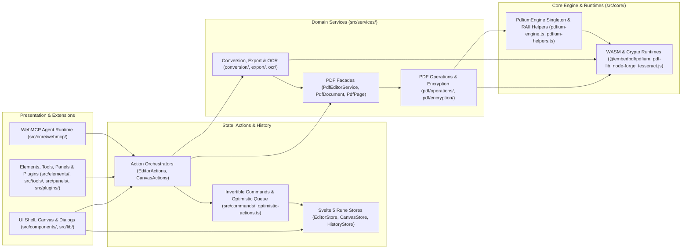

# KeaPDF

[](LICENSE)
[](https://svelte.dev/)
[](https://pdfium.googlesource.com/pdfium/)
[](https://bun.sh/)

A client-side PDF editor built with Svelte 5, TypeScript, Tailwind CSS v4, and PDFium WebAssembly. All document processing runs locally in the browser.

> [!NOTE]
> KeaPDF is in early beta.

## Features

- **In-Place Text Editing**: Edit PDF text directly while preserving embedded fonts and styling, with automatic paragraph detection, word wrapping, and table cell isolation.
- **Canvas Overlays and Annotations**: Add and burn rich text, text highlights, vector shapes, lines and arrows with endpoint snapping, freehand ink, images, comments, and barcodes into PDF content streams, or remove items with the cross-layer eraser.
- **Forms, Signatures, and Redaction**: Fill, extract, and create AcroForm fields. Sign documents with PKCS#7 / PAdES-B-LT digital certificates, RFC 3161 timestamps, incremental multi-signature revisions, signature verification, or drawn and typed e-signatures. Permanently redact text and images or sanitise document metadata.
- **Page Layout, Outlines, and Imposition**: Merge, split, reorder, rotate, crop, and scale pages. Manage PDF bookmark outlines and document metadata, add page numbers, Bates numbering, headers, and footers, or generate N-up, booklet, poster, and cut-and-stack layouts.
- **Conversion and Export**: Convert GFM Markdown (with Mermaid diagrams and LaTeX maths), HTML, DOCX, PPTX, and spreadsheets (XLSX, CSV, TSV) to PDF. Export PDFs to Word, PowerPoint, Excel, CSV, HTML, Markdown, plain text, images (PNG/JPEG), and flattened or compressed PDFs.
- **OCR and Colour Adjustments**: Run Tesseract OCR in Web Workers to add searchable text layers to scanned pages, and adjust page colour, contrast, greyscale, and monochrome levels.
- **Multi-Document Workspace and Plugins**: Manage multiple open documents with isolated undo/redo history stacks, a plugin API, and W3C WebMCP tools.

## Technology Stack

| Layer | Technology | Role |
|:---|:---|:---|
| **Runtime & Package Manager** | [Bun](https://bun.sh/) | Package management (`bun.lock`), script runner, and test execution |
| **Framework** | [Svelte 5](https://svelte.dev/) | Reactive UI using Runes (`$state`, `$derived`, `$props`, `$effect`) and Snippets |
| **Language** | [TypeScript](https://www.typescriptlang.org/) | Static typing (`ES2022` target) |
| **Styling & UI** | [Tailwind CSS v4](https://tailwindcss.com/) + `bits-ui` | OKLCH design tokens, `paneforge` split panes, and `lucide-svelte` icons |
| **PDF Engine** | `@embedpdf/pdfium` + `pdf-lib` | WebAssembly PDFium rendering/FFI operations and AcroForm/revision serialisation |
| **Cryptography & OCR** | `node-forge` + `tesseract.js` | PKCS#7 signing, RC4/AES encryption preservation, and Web Worker OCR |
| **Deployment** | [Cloudflare Workers](https://workers.cloudflare.com/) | Static asset hosting via Wrangler (`wrangler.toml`) and PWA service worker caching |

## Getting Started

### Prerequisites

- [Bun](https://bun.sh/) v1.0 or later.

### Installation

```bash
git clone https://github.com/amooo-ooo/pdf-editor.git
cd pdf-editor
bun install
bun run dev
```

The development server starts at `http://localhost:3000`.

### Available Scripts

| Command | Description |
|:---|:---|
| `bun install` | Install dependencies using `bun.lock` |
| `bun run dev` | Start the Vite development server on port 3000 |
| `bun test` | Run the test suite via the Bun test runner |
| `bunx svelte-check` | Run Svelte 5 and TypeScript diagnostics |
| `bun run build` | Run type-checks and build the production bundle into `dist/` |
| `bun run preview` | Preview the production build locally |
| `bun run deploy` | Build and deploy to Cloudflare Workers via Wrangler |
| `bun run find-style <query>` | Scan stylesheets and components for CSS tokens, classes, and variants |

## Architecture

Dependencies flow from the UI shell and extension registries through reactive rune stores and domain services to the WebAssembly runtime:



### Project Structure

```text
src/
├── commands/       # Invertible Command classes for undo/redo history and coalescing
├── components/     # Svelte 5 UI shell, canvas viewport, dialogs, and inspector panels
├── core/           # PDFium WASM singleton, RAII helpers, registries, feature flags, and WebMCP
├── elements/       # Canvas overlay element definitions and Svelte 5 renderers
├── lib/            # Shared UI primitives (shadcn-svelte) and interaction hooks
├── panels/         # Built-in sidebar panel registrations
├── plugins/        # Built-in plugins consuming the Plugin API
├── services/       # PDF facades, FFI operations, encryption, conversion, export, and OCR
├── stores/         # Svelte 5 rune stores (*.svelte.ts) and async actions (*-actions.ts)
├── styles/         # Component and layout stylesheets
├── tools/          # Interactive canvas tools (Select, Hand, Text, Highlight, Pen, Redact, Note, Eraser)
├── types/          # Shared TypeScript interfaces
└── utils/          # Geometry, snapping, keyboard shortcuts, and file utilities
```

### Core Design Principles

- **Process-Wide WASM Singleton**: `PdfiumEngine` (`src/core/pdfium-engine.ts`) manages a single PDFium WebAssembly instance with explicit heap allocation and deallocation.
- **RAII Handle Management**: `withPageHandle` and `withTextPageHandle` (`src/core/pdfium-helpers.ts`) wrap native handles in `try...finally` blocks to ensure deterministic cleanup.
- **Optimistic Mutation Queue**: Page edits and rotations update visual state synchronously while queuing background WASM mutations and coalescing rapid bursts (`src/core/optimistic-actions.ts`).
- **Unproxied Binary Buffers**: Raw PDF `ArrayBuffer` payloads and in-memory encryption credentials are stored in plain JavaScript `Map` structures outside Svelte `$state` proxies (`src/stores/editor.svelte.ts`).
- **Invertible Command History**: Mutations dispatch `Command` objects with symmetric `execute()` and `undo()` methods and a 1000ms coalescing window for continuous interactions (`src/core/command.ts`).

## Keyboard Shortcuts

| Shortcut | Action |
|:---|:---|
| `Ctrl+O` / `Cmd+O` | Open document |
| `Ctrl+S` / `Cmd+S` | Export PDF document |
| `Ctrl+Z` / `Cmd+Z` | Undo last action |
| `Ctrl+Shift+Z` / `Ctrl+Y` | Redo last undone action |
| `Ctrl+D` / `Cmd+D` | Duplicate selected element or text span |
| `Ctrl+]` / `Ctrl+[` | Bring selected element forward / send backward |
| `Ctrl+Shift+]` / `Ctrl+Shift+[` | Bring selected element to front / send to back |
| `Ctrl+=` / `Ctrl+-` | Zoom in / zoom out |
| `Ctrl+0` | Reset zoom to 100% |
| `V` | Activate Select tool |
| `Space + Drag` | Pan canvas viewport |
| `Enter` | Apply active crop or clear selection |
| `Escape` | Cancel active crop, inline edit, or clear selection |
| `Delete` / `Backspace` | Delete selected element or text span |
| `PageUp` / `PageDown` | Navigate between pages |

## Security

- **Local Execution**: Document rendering, editing, conversion, OCR, and signing run in browser memory.
- **Encryption Preservation**: Password-protected PDFs (ISO 32000 revisions 2 to 6: RC4, AES-128, and AES-256) retain their encryption parameters and permissions across edits (`src/services/pdf/encryption/`).
- **Signature Integrity**: Signed documents emit unmodified bytes verbatim and append subsequent signatures as ISO 32000-1 incremental updates (`src/services/pdf/operations/signature-revision-ops.ts`).
- **Content Redaction**: Permanently strips underlying text glyphs and wipes raster image pixels within redaction bounds before burning vector masks (`src/tools/redact-tool.ts`, `src/services/pdf/operations/text-edit-ops.ts`).
- **Document Sanitisation**: Strips metadata, XMP streams, embedded attachments, JavaScript actions, hidden layers, and private application data (`src/services/pdf/operations/sanitize-ops.ts`).

## Licence

Licensed under the GNU Affero General Public License v3.0 (AGPL-3.0). See [LICENSE](LICENSE) for details.
